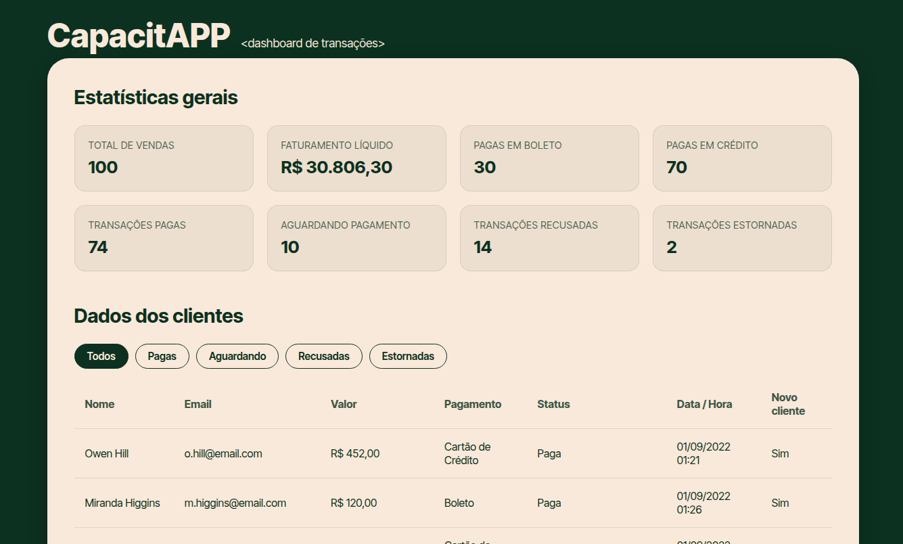

# CapacitAPP - a simple Dashboard of transactions

A small and quick web project i made for my junior company internal onboarding to showcase TypeScript and REST API basic fundamentals that was based in the ORIGAMID typescript course. I picked up from my other account and did a quick clean up and small improvements.



## Description
The app fetches transaction data directly from the Origamid REST API, validates and types the payload, calculates overall financial metrics (such as total sales, net revenue, and payment methods), and dynamically renders everything into a clean interactive interface.

## Technologies Used
- **Linguagem:** TypeScript / JavaScript (ES6+)
- **Estilização:** CSS3
- **Execução:** HTML5

## Run
```bash
npm install
npm run build
npx serve .